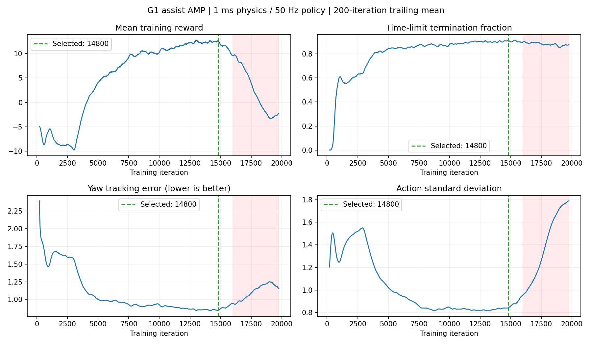

# G1 Assist AMP reproduction

复现改造后的 Unitree G1（`g1_29dof_assist_v1`）粗糙地形 AMP 训练和第 **14800 轮**策略。包含可运行源码、原始改造 USD、动作参考数据、完整 checkpoint、训练记录及跨平台 Python 启动脚本。

**推荐权重按训练日志选择，尚未通过统一爬楼成功率测试。** 第 14800 轮之前连续 1000 轮的平均奖励最高；后续训练出现奖励下降，因此保留这一阶段用于复现。完整训练最终由用户停止于第 19748 轮。



## 1. 环境

云端验证平台：Ubuntu 24.04、Python 3.12、RTX 4090 24 GB、NVIDIA 驱动 580.126.09。

| 组件 | 已验证版本 |
|---|---|
| Isaac Sim | **6.0.0.1** |
| Isaac Lab | 固定提交 `28a37cecdd433c22d9eabd6a5954add9f13a8951` |
| PyTorch | 2.11.0 |
| rsl-rl-lib | 5.4.1 |
| Newton / Viser | 1.2.1 / 1.1.1 |
| 原 legged_lab | `f33a18904e5209d9aceb95ef78ed82412c5f2072` 加本仓库配置 |

Isaac Lab 分发元数据显示 `6.1.11`，请以**固定 Git 提交**为准，不要自行换成其他 Isaac Lab 大版本。`environment/installed-packages.json` 记录全部包版本。完整 freeze 文件是环境清单，不建议直接安装到 Windows。

本仓库不捆绑 Isaac Sim 运行库、虚拟环境或驱动。需 NVIDIA GPU，用户自行阅读并接受 NVIDIA 安装协议。安装方式参考 [Isaac Sim 官方 Python 安装文档](https://docs.isaacsim.omniverse.nvidia.com/6.0.0/installation/install_python.html)。**不要因为官网最新版变化而自动升级本实验的运行时。**

### Linux 安装

```bash
git clone https://github.com/libailuG/g1-assist-amp-repro.git
cd g1-assist-amp-repro
python3.12 -m venv .venv
source .venv/bin/activate
python -m pip install --upgrade pip
# 已有 Isaac Sim 6.0.0.1 的独立环境可跳过创建虚拟环境，直接激活该环境。
# 在阅读并接受 NVIDIA 协议后，安装固定运行时与依赖：
python scripts/setup_env.py --install-isaacsim
python scripts/repro.py verify
```

`setup_env.py` 在独立目录克隆固定 Isaac Lab 提交，再以 editable 方式安装本项目。若已有这个提交的 Isaac Lab，可传 `--isaaclab /path/to/IsaacLab`；脚本不会修改不匹配的已有 checkout，也不会静默替换其他版本的 Isaac Sim。

### Windows 本地电脑

在具有 NVIDIA GPU 的电脑上使用 **Python 3.12 独立环境**。PowerShell 示例：

```powershell
git clone https://github.com/libailuG/g1-assist-amp-repro.git
cd g1-assist-amp-repro
py -3.12 -m venv .venv
.\.venv\Scripts\python.exe -m pip install --upgrade pip
.\.venv\Scripts\python.exe scripts/setup_env.py --install-isaacsim
.\.venv\Scripts\python.exe scripts/repro.py verify
.\.venv\Scripts\python.exe scripts/repro.py play --num-envs 1 --viz kit
```

启动脚本兼容 Windows 路径；**本实验仅在上述 Linux 云环境实际验证，尚未在用户本地 Windows 完成安装与运行验收**。Isaac Sim 的平台轮子、驱动和依赖必须匹配。若该固定版本无法在本机安装，优先用兼容的 Linux 环境复现，不要直接在原有 Isaac Sim 5.x / Python 3.11 环境混装。即使版本、随机种子一致，GPU/平台差异也不保证从头训练结果逐位相同。

## 2. 直接 Play 第 14800 轮

激活上述环境，在仓库根目录运行：

```bash
# 本地桌面 Isaac Sim / Kit 窗口：
python scripts/repro.py play --num-envs 1 --viz kit

# 浏览器显示，物理后端仍为 Isaac Sim / PhysX：
python scripts/repro.py play --num-envs 4 --viz viser
```

Viser 地址通常为 `http://127.0.0.1:8080`，镜头跟随 env 0。播放命令一直运行，按 Ctrl+C 结束。默认 Play 配置是粗糙地形、多种参考初始状态及速度指令，不是专门的 20 cm 楼梯测试。

默认加载 `checkpoints/model_14800.pt`，也可用 `--checkpoint /path/to/model.pt`。本仓库不需要 Git LFS 即可获得该文件；`verify` 会核对 SHA-256。

原改造 USD 存在四个引用了不存在节点的传感器视觉引用，Newton/Viser 的显示模型会拒绝加载。Play 启动脚本在 `generated/play-model/` 中创建副本，**仅清除这四个无效视觉引用**；云端已验证副本与原模型所有 physics/PhysX 属性一致。原始训练模型保留。该显示用 Newton 模型不参与动力学求解。

## 3. 从头训练

```bash
# 先测试环境是否可运行；这是少量训练更新，不代表已学会行走。
python scripts/repro.py smoke --num-envs 64 --iterations 3

# 原实验规模：
python scripts/repro.py train --num-envs 8192 --iterations 30000

# 显存不足时使用较小规模，结果和吞吐会变化：
python scripts/repro.py train --num-envs 2048 --iterations 30000
```

以上训练命令均**从头训练**，不会加载 14800 轮权重。每 200 轮保存一次，日志位于 `legged_lab/logs/rsl_rl/g1_assist_amp_rough/`。本地电脑不必为了查看已有策略而重训。

Linux 若需退出 SSH 后继续训练，可使用 tmux：

```bash
tmux new -s g1-assist
source .venv/bin/activate
python scripts/repro.py train --num-envs 8192 --iterations 30000
# Ctrl+B，然后 D：离开会话，保留训练。
# tmux attach -t g1-assist：回来查看。
```

RTX 4090 上原规模曾占用约 18.5 GB 总显存，约 8.5～10 秒/轮；这些是云端观测，不是所有电脑的容量或速度保证。其他 GPU 程序可能导致 OOM。

## 4. 固定控制参数

- 任务：`LeggedLab-Isaac-AMP-Rough-G1-Assist-v0`，Play：`LeggedLab-Isaac-AMP-Rough-G1-Assist-Play-v0`。
- PhysX 隐式 PD：物理步长 **0.001 s / 1000 Hz**。
- 策略：`decimation=20`，每 **0.020 s / 50 Hz** 更新一次。
- 不使用积分项；动作 29 维，目标角度为默认姿态加 `0.25 × action`。

| 关节 | P | D |
|---|---:|---:|
| 髋 pitch / yaw / roll | 180 | 3 |
| 膝 | 270 | 6 |
| 腰 yaw | 360 | 7.5 |
| 腰 roll / pitch | 72 | 7.5 |
| 踝 pitch / roll | 72 | 3 |
| 肩、肘、腕各关节 | 56 | 1.3 |

扭矩上限、armature 沿用原 G1 配置，并未按质量倍率增加。最终执行器参数由 Python 配置覆盖 USD 默认驱动参数；完整定义见 `legged_lab/source/legged_lab/legged_lab/assets/unitree.py` 和新任务配置。

原 USD 显式质量合计 **79.8 kg**；四个未设质量的传感器连杆在该 PhysX 环境各得到 1 kg，标称实际质量 **83.8 kg**。训练保留躯干额外 -1～+3 kg 的启动随机化。本仓库忠实保留训练条件，没有替用户修正质量或脚底碰撞。

## 5. 第 14800 轮的记录

- `checkpoints/model_14800.pt`：原始完整 checkpoint，包含文件中保存的策略、价值网络、AMP 判别器及优化器状态；不是只导出的动作网络。
- `records/14800/params/`：该运行的实际配置快照；原云端绝对路径已替换为占位符，运行时由源码重建路径。
- `records/14800/train-through-14800.log`：截至 14800 轮的文本训练日志。
- `records/14800/tensorboard/`：从原事件文件筛选 step≤14800 的 TensorBoard summary，非根据 CSV 伪造事件。
- `records/training_metrics.csv`：整个运行直到用户停止的逐轮指标，用于观察后期回退。
- `records/14800/selection.json`：选择依据与校验值。
- `environment/provenance.json`、`SHA256SUMS.json`：版本、实验条件和完整性信息。

```bash
tensorboard --logdir records/14800/tensorboard --port 6006
```

14800 轮之前最近 200 轮：平均奖励 **12.51**，平均回合 **18.96 s**，约 **91%** 的回合达到时间上限；此前连续 1000 轮平均奖励 **12.43**，在已保存权重对应窗口中最高。**时间上限比例不是爬楼成功率，也不能单独证明步态质量。**

## 来源与许可

原项目：[zitongbai/legged_lab](https://github.com/zitongbai/legged_lab/tree/feature/v3-migration)，保留 Apache-2.0 许可及源文件头。原始改造 G1 USD 来自用户提供的模型目录。Isaac Lab/Isaac Sim 单独安装并遵循各自许可。本仓库不包含服务器 SSH 密码、私钥、GitHub token 或虚拟环境。
